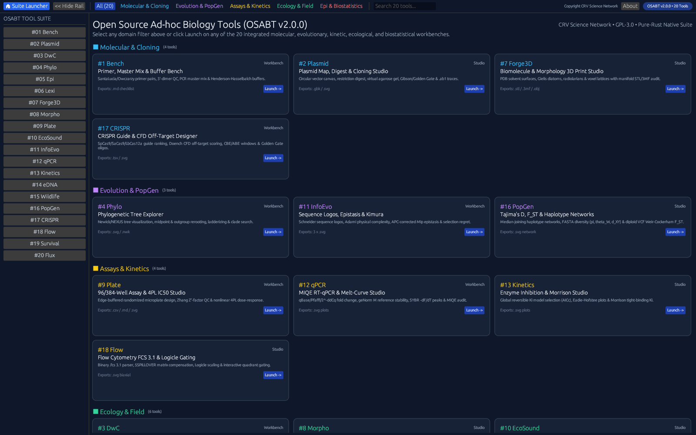

# Open Source Ad-hoc Biology Tools (`osabt` `v2.0.0`)



Unified, zero-paywall **GNU GPL-3.0-or-later** Rust library, CLI (`clap` v4), `Ratatui` TUI, and `eframe`/`egui` desktop workbench suite for the **[CRV Science Network](https://crvscience.com)**.

- **[User Guide](docs/USER_GUIDE.md)** — Installation, feature flags, interactive TUI/GUI workflows, keyboard shortcuts, and troubleshooting.
- **[Scientific Methods & Algorithms](docs/SCIENTIFIC_METHODS.md)** — Mathematical formulations, boundary guards, physical units, and peer-reviewed citations across all 20 tools.

## Quick Start

```bash
# Build and run all unit, headless GUI, integration, and validation tests
cargo test --all-features --all-targets

# Launch the unified 20-tool desktop workbench GUI
cargo run

# Launch the interactive Ratatui terminal workbench (Tool #1)
cargo run -- --tui

# Launch any TUI or GUI studio directly with built-in demo datasets
cargo run -- bench tui
cargo run -- plasmid gui
cargo run -- forge3d gui
cargo run -- ecosound gui
cargo run -- flux gui
```

### Feature Flags & Top-Level CLI Flags

- **`default = ["cli", "tui", "gui"]`** — Unified `osabt` binary with all 20 subcommands, Ratatui TUIs, and `eframe`/`egui` desktop studios.
- **`cli`** — Enables `clap` v4 CLI subcommands (`cargo build --release --no-default-features --features cli` for headless servers).
- **`tui`** — Enables interactive `Ratatui` + `crossterm` terminal studios (implies `cli`).
- **`gui`** — Enables `eframe`/`egui` desktop studios and offscreen GPU screenshot rendering.
- **`serde`** — Derives `Serialize` / `Deserialize` on core results and data structures.

| Flag / Command | Description |
| :--- | :--- |
| `osabt` | Launch the unified 20-tool desktop Workbench GUI (`eframe`/`egui`). |
| `osabt --tui` | Launch the interactive 4-tab Ratatui terminal workbench (`osabt bench`). |
| `osabt --screenshot <PNG_PATH> [--screenshot-view <1\|2\|3>]` | Render a `1600x1000` offscreen PNG (`1` = Suite Launcher, `2` = Survival & Ecotox, `3` = Plasmid Studio) and exit (`--headless-screenshot` alias supported). |
| `osabt gui [--aci <CSV>] [--stream <CSV>] [--screenshot <PNG>] [--screenshot-view <1\|2\|3>]` | Launch `OSABT Flux Studio` directly or export a headless Flux screenshot. |
| `osabt <tool> --help` | Inspect subcommands and flags for any of the 20 integrated tools below. |

## Interactive Controls & Hotkeys

| Context | Shortcut / Action | Behavior |
| :--- | :--- | :--- |
| **Workbench (`osabt`)** | `F1` | Toggle **About OSABT** modal (when not typing in a text widget). |
| **Workbench (`osabt`)** | `Esc` | Surrenders active text input focus; if unfocused, closes About/paste modal or returns to **Suite Home Launcher**. |
| **Workbench (`osabt`)** | `Ctrl+F` | Focus the top-bar tool search input (`Search 20 tools...`). |
| **Workbench (`osabt`)** | `Ctrl+B` | Toggle the left `#01`–`#20` navigation rail. |
| **Workbench (`osabt`)** | **Reset Filter** | Clears active search query and domain filter when `No matching tools` appears. |
| **Forge3D (`osabt forge3d`)** | Left-drag / Middle-drag / Scroll | Orbit (`yaw`/`pitch`), pan viewport, and zoom (`0.35x`–`3.5x`). |
| **Forge3D (`osabt forge3d`)** | `R` or **Reset Camera** | Reset orbit angles, pan offset, and zoom (guarded against text input focus). |
| **EcoSound (`osabt ecosound`)** | Left-drag / Click | Draw manual Raven call selection box; click box or row to select. |
| **EcoSound (`osabt ecosound`)** | `Delete` / `Backspace` or Right-click | Remove selected vocalization box and renumber selections (`Delete`/`Backspace` guarded against text input focus). |
| **Ratatui TUIs** | `1`–`4` / `Tab` / `j` `k` / `q` / `Esc` | Switch studio tabs, navigate tables, and exit cleanly via RAII terminal restore. |

## Complete 20-Tool Suite & CLI Subcommands (`v2.0.0`)

### Phase 1 (`v1.0.0` — Wet Lab, Cloning, Biodiversity & Bioacoustics)

| # | Subcommand | Interface | CLI Subcommands | Scientific Scope & Core Capabilities |
| :--- | :--- | :--- | :--- | :--- |
| 1 | `osabt bench` | CLI + TUI | `tui`, `design`, `audit`, `multiplex`, `gibson`, `resuspend`, `pcr-mix`, `calc` | SantaLucia (1998) & Owczarzy (2004/2008) `Tm`, hairpins, 3' dimers, `G4Hunter`, primer/TaqMan & Gibson design, Henderson–Hasselbalch buffers |
| 2 | `osabt plasmid` | CLI + GUI | `gui`, `inspect`, `map`, `digest`, `goldengate`, `align-trace` | GenBank/SnapGene/ABIF `.ab1` I/O, circular REBASE digest, virtual agarose gel, Potapov (2018) Golden Gate overhang fidelity, `.svg` map |
| 3 | `osabt dwc` | CLI + TUI | `tui`, `audit`, `scrub`, `archive`, `resolve`, `map` | TDWG Darwin Core linter, `CoordinateCleaner` spatial scrub, synonym resolver, GBIF `DwC-A` / `.geojson` / `.svg` map |
| 4 | `osabt phylo` | CLI + TUI | `tui`, `view`, `reroot`, `monophyly`, `rf-diff`, `svg` | Newick/NHX/NEXUS explorer, outgroup/midpoint rerooting, monophyly checks, Robinson–Foulds distance, rectangular/circular `.svg` |
| 5 | `osabt epi` | CLI + TUI | `tui`, `rt`, `seir`, `bayes`, `power` | Cori (2013) renewal `R_t`, RK4 `SIR`/`SEIR` ODEs, Bayesian `PPV`/`NPV` & Rogan–Gladen prevalence, Fleiss cohort & Jackson–Nelson TND power |
| 6 | `osabt lexi` | CLI + TUI | `tui`, `decode`, `cognates`, `search-root`, `flashcards` | Dynamic-programming Greek/Latin morpheme decoder, cognate trees, ICZN/ICNafp endings, Anki `.tsv` deck export |
| 7 | `osabt forge3d` | CLI + GUI | `gui`, `pdb`, `diatom`, `radiolarian`, `voxels`, `inspect-stl` | Bondi (1964) PDB Gaussian surface, Gielis (2003) diatom, radiolarian, Surface Nets + Taubin smoother, Blinn-Phong 3D studio, watertight `.stl`/`.3mf`/`.obj` |
| 8 | `osabt morpho` | CLI + GUI | `gui`, `cfu`, `leaf`, `gpa` | Otsu + Chamfer distance CFU splitter, Excess-Green (`ExG`) leaf herbivory, Rohlf & Slice (1990) 2D Procrustes (`GPA`) & PCA |
| 9 | `osabt plate` | CLI + TUI | `tui`, `plan`, `fit`, `qc` | Lundholt moat-buffered 96/384-well randomization, Zhang `Z'`-factor & `SSMD`, Sebaugh (2011) 4PL `IC50`/`EC50` fitter |
| 10 | `osabt ecosound` | CLI + GUI | `gui`, `indices`, `slice` | Radix-2 STFT spectrogram (`dBFS` colorbar + tick axes), `ACI`/`NDSI`/`H`/`ADI`/`AEI` indices, Raven Pro `.tsv` table, `.wav` clip slicer |

### Phase 2 (`v1.5.0` — Molecular Evolution, qPCR, Kinetics, eDNA & Wildlife)

| # | Subcommand | Interface | CLI Subcommands | Scientific Scope & Core Capabilities |
| :--- | :--- | :--- | :--- | :--- |
| 11 | `osabt infoevo` | CLI + TUI | `tui`, `logo`, `epistasis`, `divergence`, `kimura` | Schneider `R_seq` sequence logos, Adami physical complexity, Dunn APC-corrected `MIp` epistasis, clade `D_JS`/`D_KL`, Kimura selection bound |
| 12 | `osabt qpcr` | CLI + TUI | `tui`, `quantify`, `efficiency`, `melt`, `miqe` | MIQE RT-qPCR (`qBase`/`Pfaffl`/`2^-ddCq`), Vandesompele `geNorm` stability `M`, Savitzky–Golay SYBR `-dF/dT` melt curves |
| 13 | `osabt kinetics` | CLI + GUI | `gui`, `fit`, `inhibit`, `morrison`, `cheng-prusoff` | Michaelis–Menten/Hill/Haldane fits (NaN-safe), global `AICc` reversible `Ki` selector, Morrison (1969) tight-binding solver, Cheng–Prusoff `IC50` → `Ki` |
| 14 | `osabt edna` | CLI + TUI | `tui`, `demux`, `diversity`, `rarefy` | Dual-barcode FASTQ demux, `maxEE` & `UNOISE` denoiser, 2-parent chimera & blank audit, `Chao1`/Hill/Hurlbert rarefaction |
| 15 | `osabt wildlife` | CLI + TUI | `tui`, `occupancy`, `markrecap`, `plan` | MacKenzie (2002/2005) occupancy MLE & `(K*, S*)` planner, Chapman–Petersen/`M0`/`Mt`/`Chao Mh`/Schnabel/`CJS` mark-recapture |

### Phase 3 (`v2.0.0` — PopGen, CRISPR, Cytometry, Survival & Ecosystem Flux)

| # | Subcommand | Interface | CLI Subcommands | Scientific Scope & Core Capabilities |
| :--- | :--- | :--- | :--- | :--- |
| 16 | `osabt popgen` | CLI + GUI | `gui`, `diversity`, `vcf`, `network` | Tajima's `D`, `pi`/`theta_W`, `d_XY`/Hudson `F_ST`, diploid VCF Weir–Cockerham `F_ST`, Wigginton exact `HWE`, Bandelt Median-Joining networks |
| 17 | `osabt crispr` | CLI + TUI | `tui`, `design`, `cfd`, `base-edit` | `SpCas9`/`SaCas9`/`LbCas12a` scanning, Doench Rule Set 2 & `CFD` off-target scoring, `CBE`/`ABE` bystander windows, Golden Gate oligos |
| 18 | `osabt flow` | CLI + GUI | `gui`, `inspect`, `compensate`, `gate` | Binary ISAC `FCS 3.1` parser/writer, `$SPILLOVER` matrix inversion, Parks (2006) `Logicle` scaling, polygon/quadrant gating |
| 19 | `osabt survival` | CLI + TUI | `tui`, `km`, `cox`, `lc50` | Kaplan–Meier product-limit curves (`95%` Greenwood CI), Mantel log-rank test, Cox (1972) PH regression, Finney Probit/Logit acute `LC50` |
| 20 | `osabt flux` | CLI + GUI | `gui`, `aci`, `stream` | Farquhar–von Caemmerer–Berry (`FvCB`) A–Ci curve fitting with peaked deactivation (`Vcmax`, `Jmax`, `TPU`, `Rd`) & Odum (1956) diel `DO` stream metabolism with `P/R` & pressure/`Q10`/Arrhenius options |

## Headless Validation Benchmarks (`v2.0.0`)

Verified via `cargo test --test headless_validation` (artifacts: [`validation/osabt_benchmark_suite.csv`](validation/osabt_benchmark_suite.csv) & [`validation/osabt_validation_summary.json`](validation/osabt_validation_summary.json)):

| Suite Test | Engine / Benchmark | Measured Output |
| :--- | :--- | :--- |
| `T1` | `flux_leaf::fit_fvcb_aci_curve` (true `86 / 152 / 10.6 / 1.15`) | `Vcmax = 85.73`, `Jmax = 151.88`, `TPU = 10.56`, `Rd = 1.11`, `R² = 0.999956`, `RMSE = 0.069` |
| `T1` | `thermo::calc_perfect_duplex` (20-mer) | `Tm = 64.83 °C`, `ΔG°_37 = -25.85 kcal/mol` |
| `T1` | `survival_core` & `survival_tox` | Log-rank `χ² = 17.75` (`p = 0.000025`), Cox `HR = 7.81`, Probit `LC50 = 27.00 ug/L`, Logit `LC50 = 26.96 ug/L` |
| `T2` | `popgen_core` (FASTA 28 seqs / VCF 18×6) | `pi = 0.054674`, `Tajima's D = -0.298525`, max Hudson `F_ST = 0.794521`, WC `F_ST = 0.226361` |
| `T2` | `plasmid_digest` & `gibson` (`pCRV_DemoGFP`, `1047 bp`) | `7` unique cutters, `3` digest fragments (`1047 bp` conserved), `1047 bp` Gibson assembly, `99.60%` 4-overhang GG fidelity |
| `T3` | `flux_stream::fit_odum_stream_metabolism` (true `2.40 / 4.10 / 7.50`) | `GPP = 2.400`, `ER = 4.100`, `NEP = -1.700 g O2/m2/d`, `K600 = 7.501 d^-1`, `DO RMSE = 0.000281 mg/L` |
| `T3` | `kinetics_core` (`fit_global_reversible_inhibition` & `fit_morrison_tight_binding`) | Selects Competitive (`Ki = 21.99 nM`, Akaike weight `0.757`, `R² = 0.999995`); Morrison `[E]_T = 20.02 nM`, `Ki_app = 1.35 nM`, `R² = 0.999997` |

## License

Copyright (C) 2026 Bryan P. White — CRV Science Network.  
Licensed under the **GNU General Public License v3.0 or later** (`GPL-3.0-or-later`). See [`LICENSE`](LICENSE) and <https://www.gnu.org/licenses/gpl-3.0.txt>.

## Citation & CRV Science Apps Hub

- **CRV Science Apps Hub**: <https://crvscience.com/apps>
- **Companion Preprint (`APP-PREPRINT-08`)**: [OSABT: Unified Command-Line and Terminal Workbench for Ecophysiology, Population Genetics, and Stoichiometric Flux Balance](https://crvscience.com/apps/preprints/osabt-modular-biostatistics-toolkit)
- **Concept DOI**: [`10.5281/zenodo.24222388`](https://doi.org/10.5281/zenodo.24222388)
- **Source Repository**: <https://github.com/bpwhite/crvscience-osabt>

See [`CITATION.cff`](CITATION.cff) for machine-readable BibTeX/CFF metadata and [`validation/README.md`](validation/README.md) for validation suite documentation.
